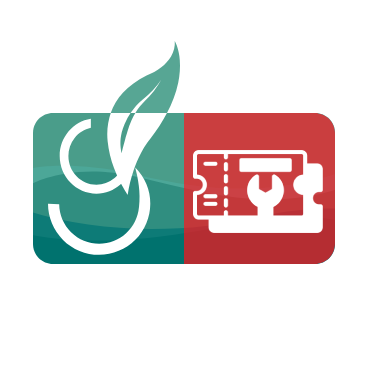
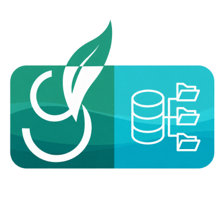
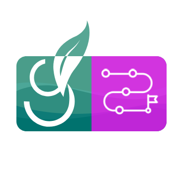

# GEMMEO

**Écosystème d'applications métier pour le conseil comptable, social et fiscal.**

Calcul des cotisations, simulations financières, optimisation,
administration des licences et des utilisateurs — le tout sur une stack
technique unifiée.

---

## Applications métier

<table>
  <tr>
    <td width="96" align="center"></td>
    <td><b>GEMMSA</b> 
    Simulation et calcul des <b>cotisations sociales agricoles (MSA)</b> :
    assiettes, abattements et cotisations par activité (viticulture, élevage,
    maraîchage / arboriculture, bois / ETA…), ATEXA, FMSE, VIVEA.</td>
  </tr>
  <tr>
    <td width="96" align="center"></td>
    <td><b>GEMCALC</b> 
    Moteur d'<b>hypothèses et de simulations financières</b> : projections et
    scénarios autour des <b>prêts</b> et du financement.</td>
  </tr>
</table>

## Administration & socle

<table>
  <tr>
    <td width="96" align="center"></td>
    <td><b>GEMMANAGER</b> 
    Plateforme <b>centrale d'administration</b> de l'écosystème : licences,
    utilisateurs, clients, rôles et droits (RBAC), accès aux services.
    Fournit l'<b>authentification commune</b> aux autres applications.</td>
  </tr>
</table>

## Support

<table>
  <tr>
    <td width="96" align="center"></td>
    <td><b>GEMSUPPORT</b> 
    Outil interne de <b>support client</b> : ingestion automatique des
    emails Gmail en tickets, classement par produit, SLA en heures
    ouvrées, RBAC par équipe/agent, statistiques et export PPTX pour le
    comité de pilotage.</td>
  </tr>
</table>

## Exploitation & infrastructure

<table>
  <tr>
    <td width="96" align="center"></td>
    <td><b>GEMSTATUT</b> 
    <b>Page de statut</b> publique des services GEMMEO et supervision
    (disponibilité, certificats, sauvegardes), avec des alertes mail au
    format commun de l'écosystème.</td>
  </tr>
  <tr>
    <td width="96" align="center"></td>
    <td><b>GEMBDD</b> 
    <b>Administration web des bases de données</b> de l'écosystème, depuis
    un point d'accès unique réservé à l'équipe technique.</td>
  </tr>
  <tr>
    <td width="96" align="center"></td>
    <td><b>GEMOPS</b> 
    <b>Exploitation</b> de l'écosystème : sauvegardes chiffrées et testées
    (outil <b>gembackup</b>), sécurité, maintenance et reprise après
    sinistre.</td>
  </tr>
</table>

## APIs

<table>
  <tr>
    <td width="96" align="center"></td>
    <td><b>GEMENTREPRISES</b> 
    <b>API d'alimentation des entreprises</b> : crée et enrichit
    automatiquement les fiches entreprises dans GEMMEO au lieu d'une saisie
    manuelle.</td>
  </tr>
    <tr>
    <td width="96" align="center"></td>
    <td><b>GEMUTILISATEURS</b> 
    Alimentation de la <b>base utilisateurs</b> d'un client GEMMEO directement
    dans GEMMANAGER, sans saisie manuelle.</td>
  </tr>
</table>

## Documentation & formation

<table>
  <tr>
    <td width="96" align="center"></td>
    <td><b>GEMDOCS</b> 
    <b>Documentation</b> de l'ensemble des APIs et services de l'écosystème
    GEMMEO.</td>
  </tr>
  <tr>
    <td width="96" align="center"></td>
    <td><b>GEMLEARNING</b> 
    Plateforme d'<b>e-learning</b> pour tous les services GEMMEO : tutoriels
    vidéo, guides et accompagnement.</td>
  </tr>
</table>

---

## Stack technique

Tous les nouveaux développements GEMMEO partagent la même architecture, afin
qu'un développeur puisse passer d'un produit à l'autre sans réapprentissage.

| Couche          | Technologies                                        |
|-----------------|-----------------------------------------------------|
| Frontend        | Vue 3 · TypeScript · Vite · Pinia · Vue Router      |
| Backend / API   | Node.js 24 · NestJS · TypeScript · Drizzle ORM      |
| Base de données | MySQL 8.4                                           |
| Tests           | Vitest                                              |
| Hébergement     | Docker · Coolify + Traefik · VPS OVH                |
| CI/CD           | GitHub Actions (tests, analyse de sécurité, déploiement automatique) |
| Existant        | WebDev / WLangage (en cours de migration)           |

---

## Gestion de projet

L'ensemble des développements est suivi de façon centralisée via le projet
**GEMMEO — Roadmap & Bug Tracker** :

- Kanban global multi-services
- Suivi des bugs et des évolutions
- Roadmap produits et versions cibles
- Documentation technique

---

GEMMEO — suite logicielle métier · développée pour l'écosystème Cerfrance.

